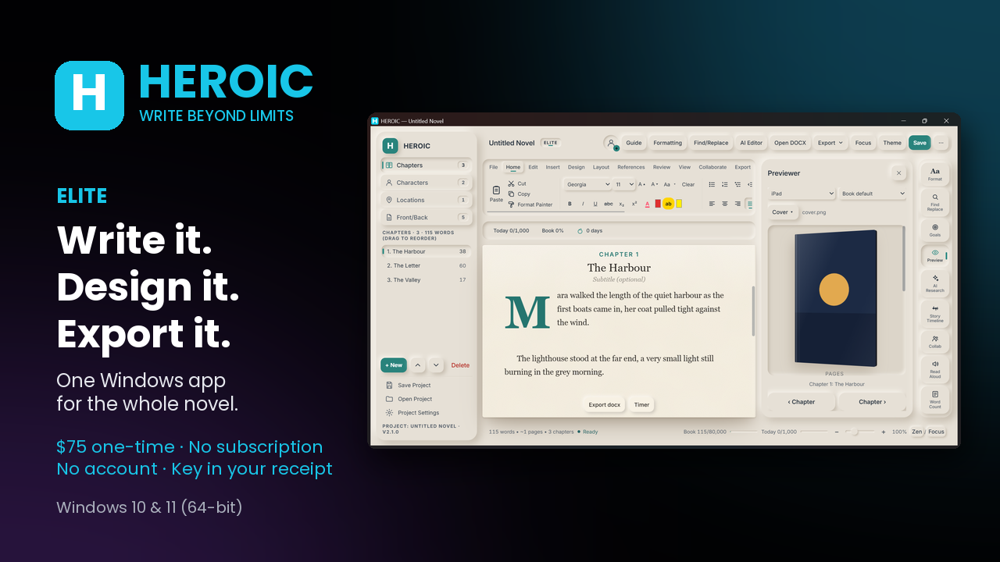
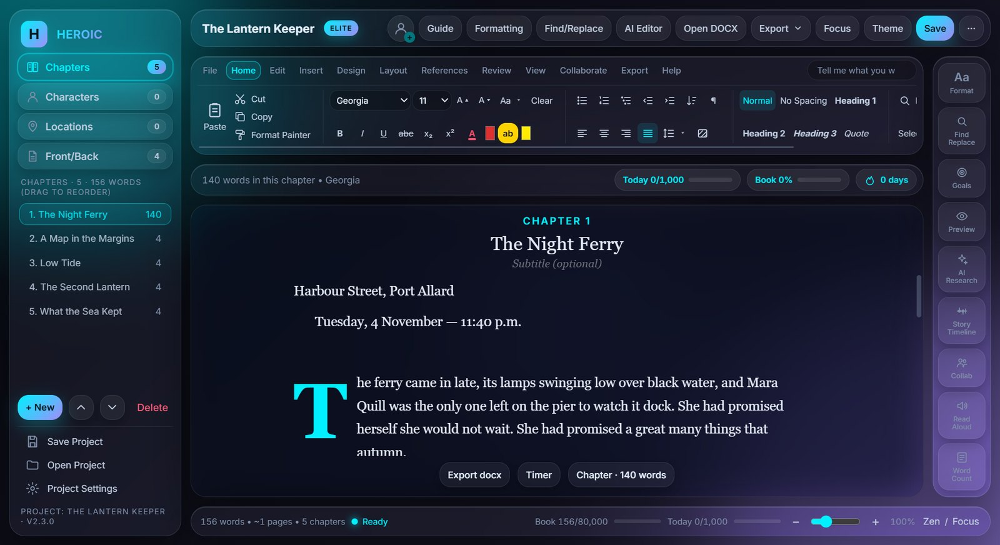
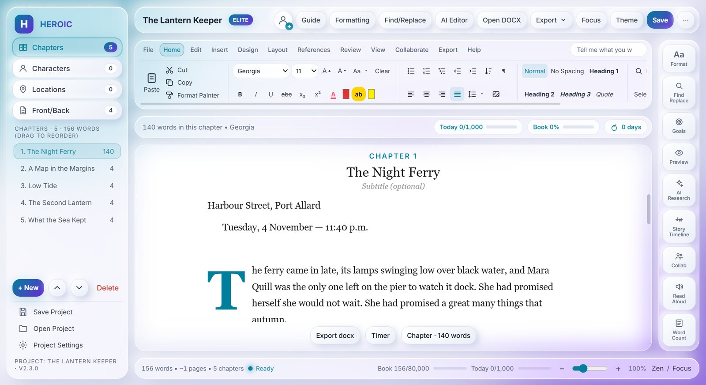
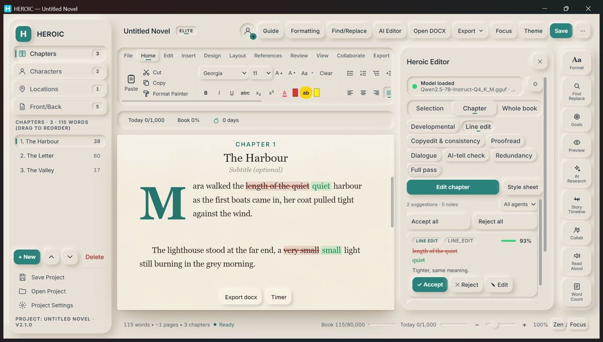
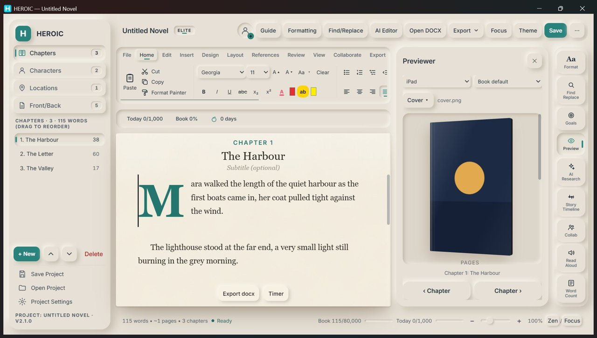
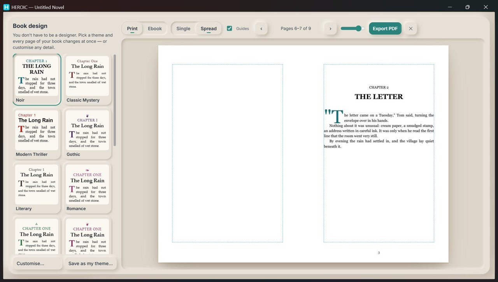
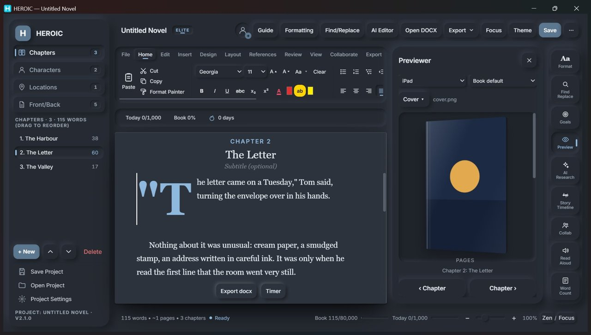
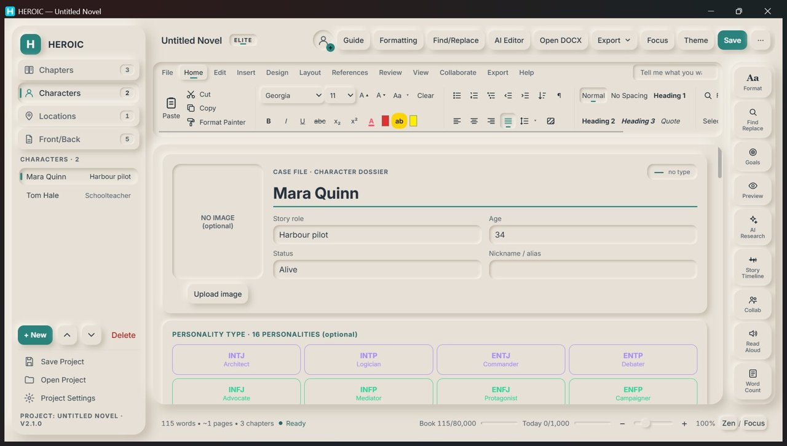

# Heroic Elite

**Write it, design it, export it: one Windows app for the whole novel.**

Heroic Elite is a novel-writing and book-design studio for Windows. Draft your manuscript, organise it into chapters, design a print-ready interior and export finished files, all on your own computer.

**$75, a one-time purchase. No subscription and no account.** Your receipt includes a license key: open Heroic, click **Upgrade** in the top bar, choose **I have a key**, paste it and click **Activate**. It is yours on that PC.

### [👉 Buy Heroic Elite on Gumroad — $75](https://jermane8.gumroad.com/l/heroic-elite)

Not sure yet? **[Try Heroic Elite free for 14 days](https://jermane8.gumroad.com/l/heroic-elite-trial)**: the full app, no account and no card. Your projects carry over when you upgrade.

> This repository is the public home page for Heroic Elite: screenshots, release notes and where to buy. Heroic Elite is commercial software; its source code is not published here.

---

## What's new in v2.3.0

- **Glass themes are back**: seven themes in the frosted-glass look of Heroic 2.0, with see-through cards, a soft glow and gradient accents. Light and Parchment are light; Dark Neon, Space Grey, Pink & Purple, Emerald Night and Sunset Ember are dark. They sit next to the nine solid themes, so there are **16 interface themes** to choose from.
- **Calmer light paper on dark themes**: White, Sepia and Rose paper now show as a soft off-white when you use a dark theme. A pure-white page next to a dark interface made many screens, especially TVs and monitors with dynamic contrast, turn their backlight up. Your exports are unchanged.
- Updating keeps the theme you already use.

  
  

## What's new in v2.2.0

- **A free 14-day trial** of the full app. Without a license key, Heroic Elite runs as a trial, and Elite-only features show a small lock. After 14 days your projects stay readable and exportable; enter a key at any time to unlock everything at once, with no reinstall.

## What's new in v2.1.0

- **A calmer, tactile look** for long writing sessions: solid, matte surfaces, soft raised keys and a paper page that follows your theme.
- **Nine interface themes**: Warm Stone, Lavender Mist, Sage Mist, Porcelain and Sandstone (light), Late-Night Desk, Slate Study, Mulberry Dusk and Forest Library (dark).
- **Drop caps on every chapter opening**, placed after any place and date lines, with a per-chapter switch to turn one off.
- **Publisher logo**: your imprint's logo, or just its name, at the foot of the title page in every export.
- **Profile photo** in the top bar and next to your name when you write together in Collab.
- **Send feedback** from inside the app, and a quick **check for new versions**.

## Write

- A book-like page with a Word-style ribbon and "Tell me" command search
- Drop caps and book indents added to chapters automatically, on the page and in PDF, Word and EPUB exports
- Two hyphens become an em dash as you type
- A live Table of Contents that updates as chapters are added, renamed, moved or deleted
- Import .docx, .txt, .md, .rtf and .odt files, several at once
- Customisable keyboard shortcuts for more than 40 commands
- Zen mode and full-screen Focus mode
- 16 interface themes, solid or frosted glass, light or dark, with eight paper colours for the page
- Automatic backups on save and before risky operations

## Design and export

- 16 book themes; adjust any theme and save it as your own
- Seven trim sizes, from 5 × 8 in to 8.5 × 11 in, with margin and bleed controls
- In-text pictures, full-page pictures, two-page spreads and chapter opener art
- Dateline chapter openings in the British crime-novel style, detected automatically
- Book cover shown as a 3D book or flat, and used as the EPUB cover
- Previewer on a printed page, Kindle, iPhone or iPad; Full Book Preview of every page as it will print
- Export to Word (.docx), print-ready PDF, EPUB and Markdown

  
  

## Plan

- Character and location dossiers
- A Story Timeline built from dates in your manuscript
- Writing goals with a streak

## Heroic Editor (AI editing)

- Seven editing passes: developmental notes, line edit, copyedit and consistency, proofread, dialogue, AI-tell check and redundancy
- Every suggestion is a tracked change with a short reason, to accept or reject. It never writes new story.
- Runs on your own PC with a local model, so your manuscript stays on your computer (the model is about 5 GB, downloaded when you choose; 16 GB RAM recommended)
- Or use your own key for OpenAI, Anthropic, Grok, Gemini or OpenRouter; Heroic Elite asks before sending any text

## Read Aloud

- Hear your manuscript with each word highlighted as it is spoken
- Natural Microsoft voices need an internet connection; Windows voices work offline

  
  

## Your work stays yours

Heroic Elite works offline and stores projects, settings and backups on your own computer, with no cloud storage and no telemetry. It goes online only for these: activating your license key once, a quick check for new versions (it sends nothing about you), and two optional features with offline alternatives, Read Aloud's natural voices and an external AI provider set up with your own key.

## Requirements

- Windows 10 or Windows 11, 64-bit
- Microsoft Edge WebView2 Runtime (included with Windows 11 and most Windows 10 PCs)
- 4 GB RAM minimum, 8 GB recommended (16 GB for local AI)
- About 300 MB of disk space, plus about 5 GB for the optional local AI model
- An internet connection once, to activate your license key (the trial needs none)

## Buy

### [Heroic Elite on Gumroad — $75 one-time](https://jermane8.gumroad.com/l/heroic-elite)

Moving to a new PC or need help? Email jauthorsewell@gmail.com.

---

Screenshots show a made-up demo project. Made by Joshua Sewell, a novelist. © 2026 Joshua Sewell. All rights reserved.
